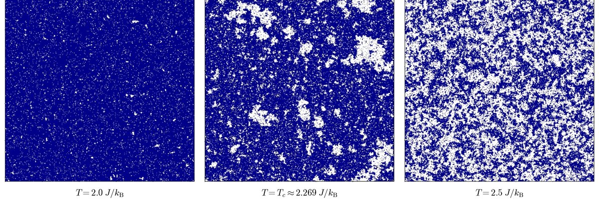
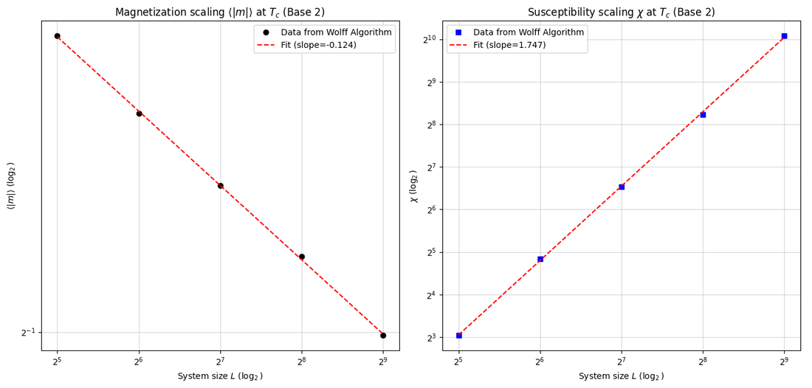
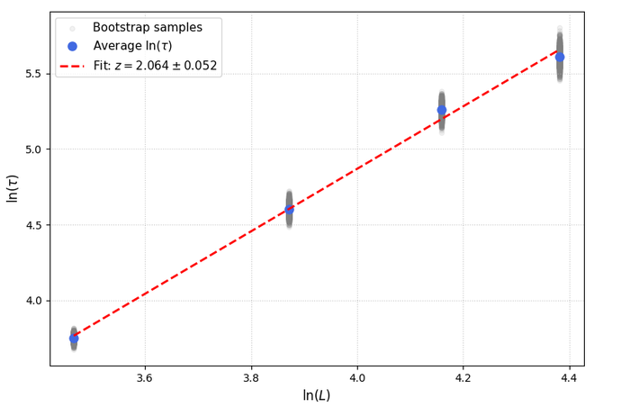
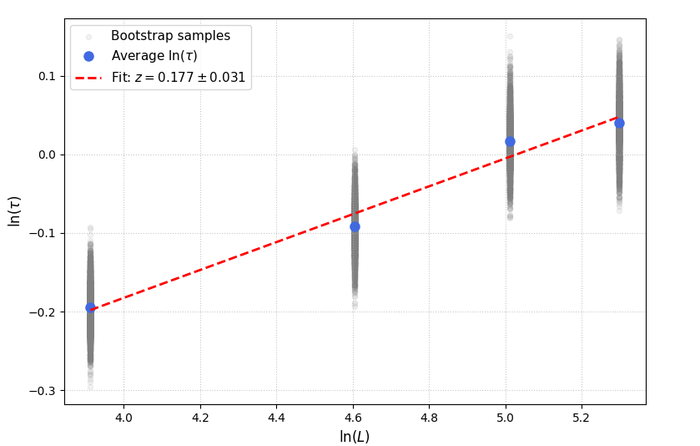

# Numerical Study of the 2D Ising Model

**A Markov Chain Monte Carlo approach**: first-year research project, École nationale des ponts et chaussées (academic year 2025–2026).

*Authors:* Benoît Bala, Mathieu Chazottes. *Supervisor:* François Chevoir (Navier Laboratory).

📄 **Full report:** [`report/Numerical_Study_of_the_2D_Ising_Model.pdf`](report/Numerical_Study_of_the_2D_Ising_Model.pdf)


<sub>512 × 512 lattice simulated with the Wolff algorithm, below, at, and above the critical temperature.</sub>

## Overview

This repository contains the code we used to simulate the two-dimensional Ising model (square lattice, periodic boundary conditions, zero field) and to study its phase transition numerically. In this project we:

- implemented the **Metropolis** algorithm (local updates) and the **Wolff** cluster algorithm, which comes from the Fortuin–Kasteleyn / Edwards–Sokal representation;
- measured the energy, the absolute magnetization $|m|$, the susceptibility $\chi$ and the specific heat $C_v$ as functions of temperature;
- estimated the critical exponents $\beta/\nu$ and $\gamma/\nu$ with **finite-size scaling** at $T_c$, using **bootstrap** error bars;
- computed **autocorrelation times** and the **dynamic exponent** $z$ of both algorithms, using a block bootstrap, to show the critical slowing down of Metropolis and how cluster updates get around it;
- ran part of the simulations on **GPU** with [Taichi](https://www.taichi-lang.org/), including a checkerboard (red/black) parallel version of Metropolis.

The theory (MCMC convergence, the FK mapping, proofs of detailed balance for Wolff and the checkerboard scheme) is covered in the report.

## Main results

| Quantity | This work | Exact / literature value |
|---|---|---|
| $\beta/\nu$ | $0.124 \pm 0.001$ | $1/8 = 0.125$ |
| $\gamma/\nu$ | $1.75 \pm 0.02$ | $7/4 = 1.75$ |
| $z$ (Metropolis) | $2.06 \pm 0.05$ | $\approx 2.17$ |
| $z$ (Wolff) | $0.18 \pm 0.03$ | $0.02 \lesssim z \lesssim 0.3$ (depends on the method) |



| Metropolis, $n \in \{32, 48, 64, 80\}$ | Wolff, $n \in \{50, 100, 150, 200\}$ |
|---|---|
|  |  |

## Repository structure

```
.
├── notebooks/
│   └── ising_metropolis_wolff_fss.ipynb    # main CPU notebook
├── scripts/
│   ├── cpu/
│   │   ├── wolff_autocorrelation.py        # rho(t) and tau_exp for Wolff
│   │   └── wolff_dynamic_exponent.py       # dynamic exponent z of Wolff
│   └── gpu/
│       ├── metropolis_dynamic_exponent_gpu.py  # dynamic exponent z of Metropolis (checkerboard, GPU)
│       └── wolff_fss_bootstrap_gpu.py          # finite-size scaling with parallel Wolff runs (GPU)
├── report/      # project report (PDF)
└── figures/     # figures used in this README (taken from the report)
```

| File | Content | Report |
|---|---|---|
| `notebooks/ising_metropolis_wolff_fss.ipynb` | `Modele_Ising` class, Metropolis and Wolff on CPU, observables vs. temperature, finite-size scaling with bootstrap uncertainties | Sec. 4.1 (Fig. 3), App. C |
| `scripts/cpu/wolff_autocorrelation.py` | Autocorrelation function of $\lvert m \rvert$ and rough estimate of $\tau_\text{exp}$ | Sec. 4.2.1, Fig. 5–6 |
| `scripts/cpu/wolff_dynamic_exponent.py` | $\tau_\text{int}$ for several sizes and $z$ for Wolff, with block bootstrap; also an exploratory version of the Niedermayer algorithm | Sec. 4.2.2, Fig. 8 |
| `scripts/gpu/metropolis_dynamic_exponent_gpu.py` | Checkerboard Metropolis on GPU, $\tau_\text{int}$ and $z$, with block bootstrap | Sec. 4.2.2, App. A, Fig. 7 |
| `scripts/gpu/wolff_fss_bootstrap_gpu.py` | Thousands of independent Wolff simulations in parallel on GPU, $\beta/\nu$ and $\gamma/\nu$ with bootstrap | Sec. 4.1, App. A |

## Getting started

Install the dependencies (Python 3.10–3.12 recommended; Taichi, which is needed only for the GPU scripts, has no wheels for newer Python versions yet):

```bash
pip install -r requirements.txt
```

Open the notebook:

```bash
jupyter notebook notebooks/ising_metropolis_wolff_fss.ipynb
```

Run a script:

```bash
python scripts/cpu/wolff_dynamic_exponent.py
```

Simulation parameters (lattice sizes, number of measurements, number of bootstrap samples, etc.) are set at the top of each script's main function. The default values are those of our longest runs (for the two dynamic-exponent scripts, exactly the ones given in the report), so **a full run can take several hours** (on CPU and on GPU). Lower them for a quick test.

The GPU scripts call `ti.init(arch=ti.gpu)`. Taichi then picks CUDA, Vulkan or Metal depending on the machine, and falls back to the CPU if no GPU is available. We ran them on an AMD Radeon RX 5600 XT (Vulkan backend) under Windows. Some settings, such as the batch sizes and the frequent `ti.sync()` calls, exist to stay within that card's VRAM and to avoid the Windows GPU timeout (TDR).

## About the code

This is a student project and the code reflects it:

- comments, variable names and printed messages are mostly in **French**;
- each script is **self-contained**, so some pieces (the `Modele_Ising` class, autocorrelation and bootstrap functions) are repeated across files instead of living in a shared module;
- the code is written for clarity and for running experiments rather than for performance on CPU (it is pure Python + NumPy). We moved to the GPU for the most expensive runs.

Earlier versions of the scripts and notebooks remain in the git history. Appendix B of the report explains how AI tools were used during the project.

## References

The main references we used (full bibliography in the report):

- M. E. J. Newman and G. T. Barkema, *Monte Carlo Methods in Statistical Physics*, Oxford University Press, 1999.
- A. Sokal, *Monte Carlo methods in statistical mechanics: foundations and new algorithms*, in *Functional Integration: Basics and Applications*, Springer, 1997.
- J. Kotze, *Introduction to Monte Carlo methods for an Ising model of a ferromagnet*, 2008, [arXiv:0803.0217](https://arxiv.org/abs/0803.0217).
- K. Yang et al., *High performance Monte Carlo simulation of Ising model on TPU clusters*, SC '19, 2019.
